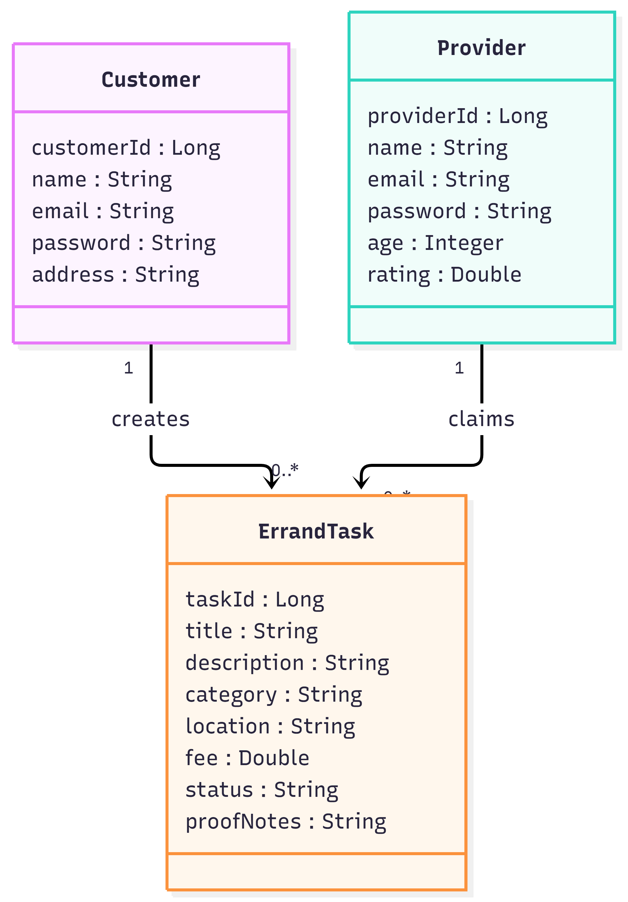

# ErrandRunner Backend API

## UML Class Diagram



---

## API Overview

**Version:** 1.0

**Base URL**

Local:

```text
http://localhost:8080/api
```

Production (Render):

```text
https://errandrunner-api.onrender.com/api
```

---

## Deployment

The application is deployed on Render and uses a Neon PostgreSQL database.

Live API:

```text
https://errandrunner-api.onrender.com/api
```

Example Endpoint:

```text
https://errandrunner-api.onrender.com/api/providers
```

---

## Provider Endpoints

| Method | Path | Purpose | Response |
|----------|----------|----------|----------|
| POST | /api/providers | Create a provider | 201 Created |
| GET | /api/providers | Get all providers | 200 OK |
| GET | /api/providers/{id} | Get provider by ID | 200 OK |
| PUT | /api/providers/{id} | Update a provider | 200 OK |
| DELETE | /api/providers/{id} | Delete a provider | 204 No Content |

### Example Provider Request

```json
{
  "name": "Joyce",
  "email": "joyce@email.com",
  "password": "password123",
  "age": 21,
  "rating": 5.0
}
```

### Example Provider Response

```json
{
  "providerId": 1,
  "name": "Joyce",
  "email": "joyce@email.com",
  "password": "password123",
  "age": 21,
  "rating": 5.0
}
```

---

## Customer Endpoints

| Method | Path | Purpose | Response |
|----------|----------|----------|----------|
| POST | /api/customers | Create a customer | 201 Created |
| GET | /api/customers | Get all customers | 200 OK |
| GET | /api/customers/{id} | Get customer by ID | 200 OK |
| PUT | /api/customers/{id} | Update a customer | 200 OK |
| DELETE | /api/customers/{id} | Delete a customer | 204 No Content |

### Example Customer Request

```json
{
  "name": "Alice",
  "email": "alice@email.com",
  "password": "customer123",
  "address": "123 Main Street"
}
```

### Example Customer Response

```json
{
  "customerId": 1,
  "name": "Alice",
  "email": "alice@email.com",
  "password": "customer123",
  "address": "123 Main Street"
}
```

---

## Task Endpoints

| Method | Path | Purpose | Response |
|----------|----------|----------|----------|
| POST | /api/tasks | Create a task | 201 Created |
| GET | /api/tasks | Get all tasks | 200 OK |
| GET | /api/tasks/{id} | Get task by ID | 200 OK |
| PUT | /api/tasks/{id} | Update a task | 200 OK |
| DELETE | /api/tasks/{id} | Delete a task | 204 No Content |
| PUT | /api/tasks/{taskId}/claim/{providerId} | Assign a provider to a task | 200 OK |

### Example Task Request

```json
{
  "title": "Pick Up Groceries",
  "description": "Need milk and bread",
  "category": "Shopping",
  "location": "Greensboro",
  "fee": 20.0,
  "status": "OPEN",
  "proofNotes": ""
}
```

### Example Task Response

```json
{
  "taskId": 1,
  "title": "Pick Up Groceries",
  "description": "Need milk and bread",
  "category": "Shopping",
  "location": "Greensboro",
  "fee": 20.0,
  "status": "OPEN",
  "proofNotes": "",
  "provider": null
}
```

---

## Claim Task Example

### Request

```http
PUT /api/tasks/1/claim/1
```

### Response

```json
{
  "taskId": 1,
  "title": "Pick Up Groceries",
  "description": "Need milk and bread",
  "category": "Shopping",
  "location": "Greensboro",
  "fee": 20.0,
  "status": "CLAIMED",
  "proofNotes": "",
  "provider": {
    "providerId": 1,
    "name": "Joyce",
    "email": "joyce@email.com",
    "password": "password123",
    "age": 21,
    "rating": 5.0
  }
}
```

---

## Technologies Used

- Java 25
- Spring Boot
- Spring Data JPA
- PostgreSQL
- Neon Database
- Maven
- Docker
- Render

---

## Domain Model

### Customer

- customerId
- name
- email
- password
- address

### Provider

- providerId
- name
- email
- password
- age
- rating

### ErrandTask

- taskId
- title
- description
- category
- location
- fee
- status
- proofNotes

### Relationships

- One Provider can claim many ErrandTasks.
- Each ErrandTask can be assigned to one Provider.

---

## Render Deployment

Public API URL:

```text
https://errandrunner-api.onrender.com/api
```

Test Endpoint:

```text
https://errandrunner-api.onrender.com/api/providers
```